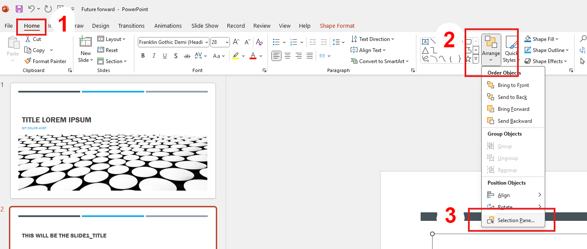
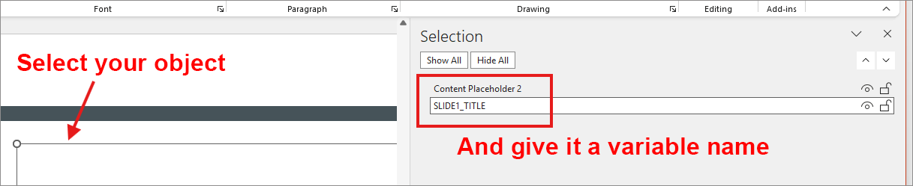
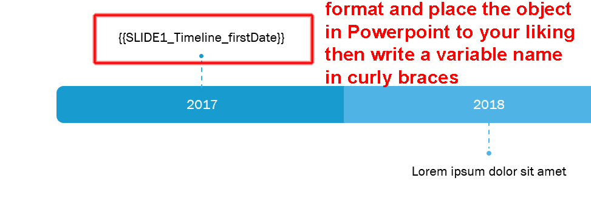

<p align="center">
  <picture>
    <source media="(prefers-color-scheme: dark)" srcset="assets/logo-dark.svg">
    
  </picture>
</p>

# ppt-template-to-pdf

**A Python script to update a PowerPoint template with variables — fill a `.pptx` deck from a YAML file, then export it to PDF.**

`ppt_template_to_pdf.py` takes a PowerPoint template, replaces the placeholders with values from a YAML data file, saves the filled deck as `.pptx`, and exports the same deck to `.pdf`. It is a command-line tool and a Python module, so it works by hand, from a script, from a scheduled job, or in CI.

People find this repo looking for:

- a **script to update PowerPoint with variables**
- a **PowerPoint template updated dynamically** at runtime
- **how to update PowerPoint in Python** without losing the template's design
- how to do a **mail merge for PowerPoint** (`{{PLACEHOLDER}}` → real values)
- how to **fill a PPTX template from Excel, YAML, JSON, or a database**
- how to **generate PowerPoint slides programmatically** and ship them as PDF

That is exactly what this does. No PowerPoint add-in, no VBA, no Office 365 subscription on the build machine (except for the optional PDF/legacy-file step).

**Quick start**

```
python -m pip install -r requirements.txt
python ppt_template_to_pdf.py "Template.pptx" "Deal data.yaml"
```

Output:

```
Template - Deal data - 2026-11-26.pptx
Template - Deal data - 2026-11-26.pdf
```

## Contents

- [What the script does](#what-the-script-does)
- [Requirements](#requirements)
- [Install](#install)
- [Use](#use)
- [Check the template first](#check-the-template-first)
- [Prepare the template](#prepare-the-template)
- [HTML inside YAML strings](#html-inside-yaml-strings)
- [YAML format](#yaml-format)
- [Use it from Python](#use-it-from-python)
- [Troubleshooting](#troubleshooting)
- [FAQ: update PowerPoint with Python](#faq-update-powerpoint-with-python)
- [How this compares to other tools](#how-this-compares-to-other-tools)
- [Search terms](#search-terms)
- [Run the tests](#run-the-tests)
- [License](#license)

## What the script does

- Opens a template with `python-pptx`.
- Reads a YAML file that maps field IDs to content.
- Finds every matching text box in the template and replaces its text.
- Keeps the template's paragraph and character formatting as the default look.
- Saves a new `.pptx` file. The template file is never modified.
- Converts a legacy `.ppt` or `.pot` template to `.pptx` first, with the installed PowerPoint.
- Exports the new `.pptx` to PDF with the installed desktop PowerPoint. Use `--no-pdf` to skip this step.

In other words: **one template, one data file, any number of decks.** The template keeps the branding, the master slides, the fonts and the layout; only the text changes.

Output names use the template name, the YAML name, and today's date:

```
Template - Deal data - 2026-11-26.pptx
Template - Deal data - 2026-11-26.pdf
```

If those files already exist, the script adds a number instead of overwriting them:

```
Template - Deal data - 2026-11-26 (2).pptx
```

Pass `--overwrite` to replace the earlier files instead.

## Requirements

- Python 3.10 or later.
- `python-pptx` and `PyYAML`.
- Legacy `.ppt` and `.pot` templates: Windows, PowerPoint, and `pywin32`. `python-pptx` cannot read the old binary format, so the script asks PowerPoint to convert the file first. This applies even with `--no-pdf`.
- PDF export: Windows, a desktop install of Microsoft PowerPoint, and `pywin32`. The Microsoft Store, web, and Mac versions of PowerPoint do not expose the COM interface. Linux and macOS work with `--no-pdf`.

## Install

```
python -m pip install -r requirements.txt
```

Or install the three packages directly:

```
python -m pip install python-pptx PyYAML pywin32
```

`requirements.txt` marks `pywin32` as Windows-only, so the same file works on Linux and macOS.

Known working versions:

| Package | Version |
| --- | --- |
| python-pptx | 1.0.2 |
| PyYAML | 6.0.4 |
| pywin32 | 312 |
| lxml | 6.1.3 |
| pillow | 13.0.0 |

If `pywin32` installs but COM calls fail with `Invalid class string`, run the post-install script once:

```
python "C:\path\to\python\Scripts\pywin32_postinstall.py" -install
```

Find the real path with `python -c "import sys; print(sys.prefix)"`.

Install the script itself to get a `ppt-fill` command:

```
python -m pip install .
ppt-fill "Template.pptx" "Deal data.yaml"
```

## Use

```
python ppt_template_to_pdf.py "Template.pptx" "Deal data.yaml"
```

Write outputs to another folder:

```
python ppt_template_to_pdf.py "Template.pptx" "Deal data.yaml" --output-dir "Output"
```

Flags:

| Flag | Effect |
| --- | --- |
| `-o`, `--output-dir DIR` | Output folder. Created if missing. Defaults to the template's folder. |
| `--no-pdf` | Create only the PPTX. Works without PowerPoint and without Windows. |
| `--dry-run` | Check the YAML and the template, print the matches, write nothing. |
| `--list-fields` | Print every text shape name and token in the template, then exit. Needs no YAML file. |
| `--overwrite` | Replace existing output files instead of adding `(2)`, `(3)`, and so on. |
| `-v`, `--verbose` | Print every field that is filled, and every text shape that is left alone. |
| `-q`, `--quiet` | Print errors only. |
| `--version` | Print the version and exit. |

Quote paths that contain spaces.

Exit codes:

| Code | Meaning |
| --- | --- |
| 0 | Success. |
| 1 | Unexpected failure. |
| 2 | Bad arguments, missing files, or invalid YAML. |
| 3 | The YAML refers to IDs the template does not contain. |
| 4 | PDF export failed. The PPTX may still exist. |

## Check the template first

`--list-fields` prints every text shape, its slide, and its current text. It also shows which IDs are already written as `{{tokens}}`.

```
$ python ppt_template_to_pdf.py "Template.pptx" --list-fields
Slide  Shape name         Match by       Text
------------------------  -------------  --------------------
1      CLIENT_NAME        shape name     {{CLIENT_NAME}}
1      TRANSACTION_TITLE  shape name     Project ___ Financing
3      TextBox 7          token SUMMARY  {{SUMMARY}}
```

Use those names, or the IDs inside the braces, as top-level YAML keys.

Preview a real run without writing files:

```
python ppt_template_to_pdf.py "Template.pptx" "Deal data.yaml" --dry-run -v
```

## Prepare the template

### Method 1 (recommended): shape names

1. Open the template in PowerPoint.
2. Go to Home → Arrange → Selection Pane.
3. Double-click a shape name in the pane and rename it to the field ID.
4. Use the same ID as the top-level YAML key.





Names you can use:

```
CLIENT_NAME
TRANSACTION_TITLE
KEY_POINTS
```

The screenshot uses `assets/screenshots/demo-template.pptx`. Open that file, show the Selection Pane, and the four names appear as in the picture.

### Method 2: tokens in the text

1. Type a token such as `{{CLIENT_NAME}}` inside a text box.
2. Use the ID inside the braces as the top-level YAML key.
3. Leave the shape name alone. Tokens match on the text, not on the name.



In the screenshot the shape is still called `TextBox 7`, and the script fills it because its text contains `{{DISCLAIMER}}`.

### Matching rules

- Shape names match exactly first.
- Shape names then match case-insensitively, with a warning.
- Tokens match with or without inner spaces, and are case-insensitive.
- Shapes inside groups are searched.
- One ID can match several shapes. Every match gets the same content.
- If one shape is targeted by two IDs, the script warns and the later ID wins.

Tables and pictures have no text frame, so the script skips them. Put the ID on a real text box.

Templates can be `.pptx`, `.pptm`, `.potx`, `.ppt`, or `.pot`. The output is always `.pptx`, so macros are dropped.

Legacy `.ppt` and `.pot` files are converted to `.pptx` in a temporary folder with PowerPoint before the script fills them. The temporary copy is deleted at the end. The output name still uses the original template name, without the old extension.

## HTML inside YAML strings

Write formatting in the data file instead of clicking through PowerPoint. Values may contain a small set of HTML tags; the script turns them into real PowerPoint runs, paragraphs and bullets.

Supported tags:

- `b`, `strong`: bold.
- `u`: underline.
- `font`: `color` and `size` attributes.
- `span`: inline CSS with `color` and `font-size` only.
- `ul`: bulleted list.
- `ol`: numbered list.
- `li`: one paragraph in the current list.
- `br`, `p`: paragraph breaks.

Examples:

```yaml
SLIDE1_TITLE: "<b>Bold text</b> and <u>underlined text</u>"
SLIDE1_Subtitle: "Text with no formatting"
COLOURED: '<font color="#C00000">Red text</font>'
SIZED: '<font size="14">14-point text</font>'
COMBINED: '<span style="color:#C00000; font-size:14pt"><b>Red, bold, 14-point text</b></span>'

Slide2_BULLETS: |
  <ul>
    <li>First bullet</li>
    <li>Second bullet with <b>bold text</b></li>
  </ul>

Slide3_multiline_steps: |
  <ol>
    <li>First step</li>
    <li>Second step</li>
  </ol>
```

To print a tag as text, escape the angle brackets:

```yaml
LITERAL_TAG: "&lt;b&gt;This is not bold&lt;/b&gt;"
```

Use single quotes around a YAML value that contains HTML with double-quoted attributes. Double-quoted YAML strings end at the first inner `"`. The alternative is a block value with `|`.

## YAML format

The top level must be a mapping of `ID: content`.

A value can be:

- A plain string. Actual HTML tags in the string are converted to formatting.
- A number or boolean. Printed as plain text.
- A mapping with `text`, `runs`, or `paragraphs`.

Full example:

```yaml
CLIENT_NAME: "Example Energy Pte. Ltd."

TRANSACTION_TITLE:
  runs:
    - text: "Project "
    - text: "Sophia"
      bold: true
      colour: "#C00000"
    - text: " Financing Proposal"

SUMMARY:
  paragraphs:
    - runs:
        - text: "THEBANK "
          bold: true
        - text: "is proposing a structured financing solution."
    - bullet: true
      level: 0
      runs:
        - text: "Senior facility: "
          bold: true
        - text: "USD 150 million"
          colour: "#C00000"
    - bullet: true
      level: 0
      runs:
        - text: "Expected tenor: "
          bold: true
        - text: "10 years"
          underline: true
    - number: true
      level: 1
      runs:
        - text: "Subject to credit approval"
          italic: true
          colour: "#666666"

DISCLAIMER:
  text: "Strictly private and confidential"
  bold: true
  underline: true
  colour: "#C00000"
  size: 9
  align: "center"
```

Run fields:

- `text`: the visible text.
- `bold`, `italic`, `underline`: `true` or `false`. The strings `"true"`, `"false"`, `"yes"`, `"no"`, `"on"`, and `"off"` also work.
- `colour` or `color`: six hex digits, with or without `#`, for example `#C00000`.
- `size`: font size in points, between 1 and 400.
- `font`: font family name, for example `Arial`.

Paragraph fields:

- `runs`: list of runs. A run can also be a plain string.
- `text`: shorthand for one run. Style keys such as `bold` move to that run.
- `bullet`: `true` or `false`.
- `bullet_char`: bullet character. Default is `•`. Must be one character.
- `number`: numbered list marker instead of a bullet.
- `level`: indentation level, `0` to `8`.
- `align`: `left`, `center`, `centre`, `right`, or `justify`.

Paragraph and run formatting that the YAML does not set comes from the first paragraph and first run of the template text box.

Unknown keys are rejected rather than ignored. A typo like `colourr` reports `did you mean 'colour'?`.

## Use it from Python

The script is a normal importable module. Call `main()` with the same arguments you would pass on the command line:

```python
from ppt_template_to_pdf import main

exit_code = main(["Template.pptx", "Deal data.yaml", "--no-pdf", "-q"])
```

Use that to fill a template inside an existing ETL job, a Flask view, a Django management command, or a notebook.

A loop over a spreadsheet makes one deck per row:

```python
import yaml
from pathlib import Path
from ppt_template_to_pdf import main

rows = [
    {"CLIENT_NAME": "Example Energy Pte. Ltd.", "TRANSACTION_TITLE": "Project Sophia"},
    {"CLIENT_NAME": "Northwind Ports Ltd.", "TRANSACTION_TITLE": "Project Harbour"},
]

for index, row in enumerate(rows, start=1):
    data_file = Path(f"deal-{index}.yaml")
    data_file.write_text(yaml.safe_dump(row, allow_unicode=True, sort_keys=False), encoding="utf-8")
    main(["Template.pptx", str(data_file), "--output-dir", "Output", "--no-pdf"])
```

If you need lower-level control, `python-pptx` is the library underneath and everything here is plain Python: open the presentation, walk the shapes, set `text_frame.text`, save. This repo adds the YAML layer, the token matching, the formatting rules and the PDF export on top of that.

## Troubleshooting

| Message or symptom | Cause | Fix |
| --- | --- | --- |
| `Template file not found` | Wrong path or missing file. | Check the path. Quote paths with spaces. |
| `YAML file not found` | Wrong path. | Check the path and the `.yaml` / `.yml` extension. |
| `Template must be one of .pot, .potx, .ppt, .pptm, .pptx` | The file is not a PowerPoint file, or it is a `.pps` / `.ppsx` slide show. | Open the file in PowerPoint and save it as `.pptx`. |
| `Reading a .ppt or .pot template needs Windows...` | The template is the old binary format and PowerPoint is not available. | Run on Windows with PowerPoint installed, or convert the file once with PowerPoint (File → Save As → `.pptx`) or `soffice --convert-to pptx "template.ppt"`. |
| `Data file must be .yaml or .yml` | The data file has another extension. | Rename the file or fix the extension. |
| `Output path is a file, not a folder` | `-o` points at a file. | Pass a folder path, or delete the file. |
| `YAML COMMENT ERROR` | A double-quoted value contains `colour="#C00000"`. YAML reads `#` as a comment and cuts the value there. | The message prints the fixed line. Wrap the value in single quotes or use a `\|` block. |
| `YAML SYNTAX ERROR` with line and column | Bad quotes, tabs, or indentation. | Read the quoted line and the suggestion under it. Use spaces, never tabs. |
| `found duplicate key` | The same ID appears twice. | Remove the duplicate or rename one of them. |
| `ID ... is not text` | A key such as `NO`, `ON`, or `YES` was read as a boolean, not as a word. | Quote the key: `'NO': content`. |
| `is empty` or `contains no IDs` | The YAML file has no entries. | Add at least one `ID: content` entry. |
| `is not valid UTF-8 text` | The file was saved in a legacy code page. | Save the YAML file as UTF-8. A UTF-8 BOM is fine. |
| `the top level must be a mapping` | The YAML file is a list or a single value. | Start the file with `ID: value` lines at column zero. |
| `These YAML IDs were not found in the template` | Shape name differs from the YAML key. The field is a table or a picture. | The message suggests close matches. Run `--list-fields` to copy the exact name. |
| `unknown content key` or `unknown run key` | A key is misspelled or not supported. | Use a suggested key. The message lists every allowed key. |
| `invalid colour` | Colour is not six hex digits. | Use `#C00000`. Colour names such as `red` do not work. |
| `unsupported HTML tag` | The tag is not in the supported list. | Use a supported tag. Escape the angle brackets to print a tag as text. |
| `mismatched HTML closing tag` or `unclosed HTML` | Tags are not closed or are nested in the wrong order. | Close every tag, inside out: `<b><u>text</u></b>`. |
| `unsupported CSS property` | `span style` uses a property other than `color` or `font-size`. | Remove the property, or use a `font` tag or run fields. |
| `use 'bullet' or 'number', not both` | One paragraph asks for a bullet and a number. | Keep one of the two. |
| `'bullet_char' must be a single character` | The bullet character is a longer string. | Use one character. |
| `unsupported alignment` | `align` value is not in the list. | Use `left`, `center`, `centre`, `right`, or `justify`. |
| `PDF export needs Windows` | The script ran on Linux or macOS. | Add `--no-pdf`, or run on Windows. |
| `PDF export needs pywin32` | `pywin32` is missing from the active environment. | Install it with `python -m pip install pywin32`. Check the interpreter is the same one, for example inside a venv. |
| `PowerPoint automation is not registered` | COM cannot start PowerPoint. Usually a Microsoft Store install or broken `pywin32` registration. | Install desktop PowerPoint. Run the `pywin32_postinstall.py` script shown above. |
| `PowerPoint could not open the file` | The PPTX is open, read-only, or in a protected or blocked location. | Close the file. Move it out of OneDrive or a network share. Unblock it in file Properties. |
| PPTX created but no PDF | Export failed, or PowerPoint is unavailable. | Read the error text. Fix PowerPoint, then run again. |
| `PDF export failed after 3 attempts` | PowerPoint kept rejecting the call. | Close every open Office window and run again. |
| `Cannot write ...` | The output file is open, or the folder is read-only. | Close the file. Write to a folder you own. |
| Output path is long warning | Windows path limit. | Use a short `-o` folder such as `C:\Out`. |
| Text overflows the box | The template box is too small. | Enlarge the box or enable autofit in the template. |
| PDF fonts differ from the template | A template font is not installed on this machine. | Install the font, or save the template with an available font. |

The script never prints a traceback for expected problems. It prints `ERROR: ...` to stderr and returns a code from the table above. Check `$LASTEXITCODE` in PowerShell and `$?` in Bash.

## FAQ: update PowerPoint with Python

**How do I update PowerPoint text with Python?**
Install `python-pptx`, open the file with `Presentation("Template.pptx")`, walk `slide.shapes`, and set `shape.text_frame.text`. That is the low-level path. This repo wraps it: you keep the template, put the values in a YAML file, and run one command. See [What the script does](#what-the-script-does).

**Is there a script to update a PowerPoint template with variables?**
Yes — that is what `ppt_template_to_pdf.py` is. Variables are top-level YAML keys; the matching shape name or `{{token}}` in the deck is replaced with the value.

**Can a PowerPoint template be updated dynamically, at runtime?**
Yes. The script is a single command with a meaningful exit code, so you can call it from Python, PowerShell, Bash, a cron job, Task Scheduler, GitHub Actions, Azure Pipelines, or Jenkins. Generate the YAML from your database or API, then fill the template.

**How do I replace `{{PLACEHOLDER}}` tokens in a PPTX file?**
Name the shapes with the placeholder text or type the tokens directly into the text boxes, then pass a YAML mapping of token → value. `--list-fields` shows which tokens the template already contains.

**How do I do a mail merge in PowerPoint?**
PowerPoint has no built-in mail merge for slides. The usual workaround is one YAML file per record plus this script in a loop — see [Use it from Python](#use-it-from-python).

**Can I generate PowerPoint slides from Excel or a database?**
Yes. Export each row to YAML (or build the YAML in Python), then call the script once per row. The template's design, master slides and fonts are reused every time.

**Does it keep my template's formatting?**
Yes. The script writes text into existing boxes and takes unset paragraph and run formatting from the first paragraph and first run of that box, so the template's look stays. Explicit `bold`, `colour`, `size`, `bullet` and `align` values in the YAML override it.

**Do I need Microsoft PowerPoint installed?**
Only for PDF export and for converting legacy `.ppt` / `.pot` templates. With `--no-pdf` and a `.pptx` template, `python-pptx` alone is enough — no Office, no Windows.

**Does it work on macOS or Linux?**
The PPTX step does. Add `--no-pdf`; PDF export uses the Windows COM interface of desktop PowerPoint. On Linux, convert the result with `soffice --headless --convert-to pdf "deck.pptx"`.

**Can it insert images, charts or tables?**
Not currently. The script fills text boxes and text frames, including grouped shapes. Tables and pictures have no text frame, so they are skipped. Use `python-pptx` directly for those, or a placeholder image with the same idea.

**Can I fill dozens of fields at once?**
Yes. One YAML file can hold every field for every slide. The IDs are matched across the whole presentation, including shapes inside groups.

**Is there a way to check the template without running a real fill?**
`--list-fields` lists every text shape and token, and `--dry-run -v` reports the planned matches and writes nothing.

## How this compares to other tools

| Approach | What it gives you | Trade-off |
| --- | --- | --- |
| This repo (`ppt_template_to_pdf.py`) | Command line, YAML data file, `{{token}}` and shape-name matching, formatting, PPTX + PDF output, clear errors | Text fields only, no images or charts |
| `python-pptx` alone | Full control over shapes, tables, images, charts | You write and maintain the fill loop, the matching and the error handling |
| `python-pptx` + Jinja2 templates | Slide duplication and loops | You design the mapping and the formatting layer yourself |
| `docxtpl` | Great template filling — for Word `.docx` | Does not handle PowerPoint files |
| PowerPoint "Reuse Slides" / manual slides | No code | Not repeatable, not dynamic |
| Office Scripts / Power Automate | Cloud automation | Needs a Microsoft 365 licence and the cloud, and PowerPoint coverage is limited |

If your input is a spreadsheet and your output is a set of branded decks plus PDFs, this script is the short path.

## Search terms

Variables, placeholders, tokens, mail merge, templating, data merge, python-pptx wrapper, pptx template filler, PowerPoint automation, PowerPoint generation, PPTX to PDF, `.potx` template, `.pptm`, `python-pptx` text replacement, replace text in PowerPoint with Python, fill PowerPoint template from YAML, fill PowerPoint template from Excel, generate PowerPoint report in Python, dynamic PowerPoint decks, batch PowerPoint generation, PowerPoint CLI.

## Run the tests

```
python -m pip install -r requirements-dev.txt
python -m pytest
```

The tests cover YAML loading, the HTML parser, matching, and PPTX writing. They do not need PowerPoint. PDF export is checked by hand.

## License

MIT. See [LICENSE](LICENSE).
